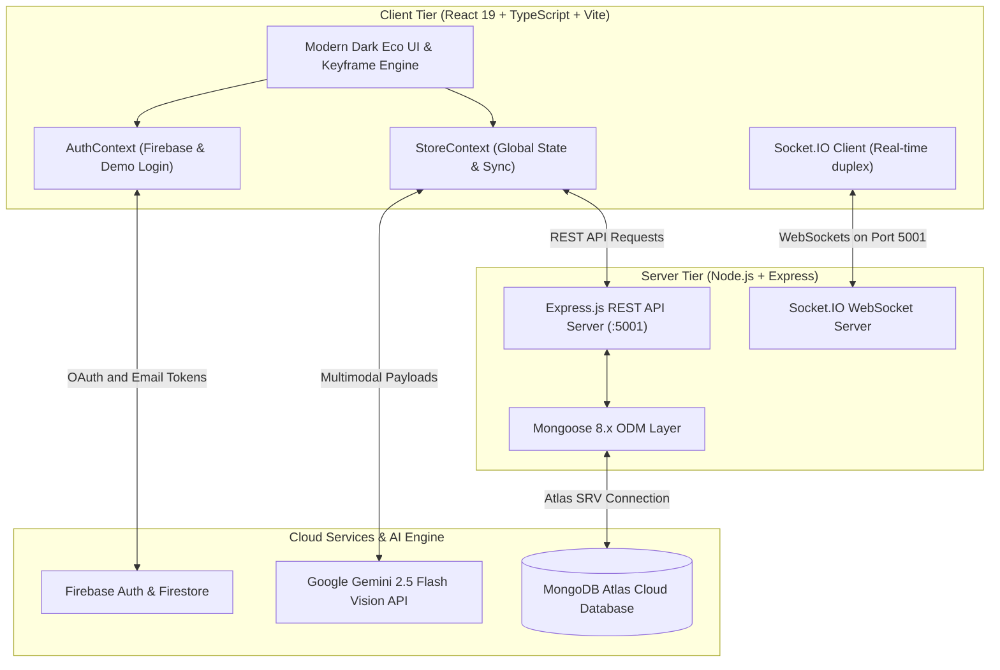

<div align="center">

# 🌿 FashionCycle
### *Give Your Wardrobe A New Life • 100% Sustainable Circular Fashion*

[](https://react.dev/)
[](https://www.typescriptlang.org/)
[](https://vitejs.dev/)
[](https://nodejs.org/)
[](https://www.mongodb.com/atlas)
[](https://socket.io/)
[](https://ai.google.dev/)
[](https://firebase.google.com/)

<br />

**FashionCycle** is an intelligent, full-stack circular fashion platform designed to divert clothing from landfills. Built with **React 19**, **Node.js/Express**, **MongoDB Atlas**, **Socket.IO**, and **Google Gemini Multimodal AI**, it enables conscious consumers to appraise, sell, repair, donate, and purchase pre-loved garments while measuring their environmental impact in real time.

[Explore Repository](https://github.com/Harry-shetty/FashionCycle) • [Report Issue](https://github.com/Harry-shetty/FashionCycle/issues) • [API Documentation](#-api-reference)

---

</div>

<br />

## ✨ Core Highlights

### 🤖 CycleBot: Multimodal AI Garment Appraisal
* **Computer Vision Inspection**: Powered by **Google Gemini 2.5 Flash**, inspecting fabric texture, brand, craftsmanship, and wear patterns from photos.
* **4-Way Circular Probability Engine**: Automatically calculates an exact percentage split summing to 100%:
  $$\text{To Sell } (P_s) + \text{To Repair } (P_r) + \text{To Donate } (P_d) + \text{To Recycle } (P_c) = 100\%$$
* **Intelligent Valuation**: Recommends resale price ranges in Indian Rupees (`850₹ – 1,450₹`) alongside estimated CO₂ diverted and water saved.
* **Persistent History**: All past appraisal sessions are synced to MongoDB Atlas with auto-scrolling to the latest message.

### 🛍️ Circular Re-Commerce Marketplace
* **Instant Listing Studio**: Drag-and-drop or file upload strictly accepting `image/*` formats with live preview and category tagging.
* **Smart Catalog & Filters**: Real-time filtering by category (*Outerwear, Dresses, Tops, Denim, Accessories*), condition (*Like New, Excellent, Good, Fair*), price sorting, and instant search.
* **Simulated Eco-Fulfillment**: Zero-emission electric courier tracking with simulated tracking IDs (`FC-IND-XXXXXXX`) and dynamic status progression.

### 💬 Real-Time Buyer-Seller Negotiation (Socket.IO)
* **Duplex WebSocket Architecture**: Instant direct messaging without page reloads.
* **Smart Auto-Seller Agent**: Automated contextual replies for common buyer queries (*availability, pricing negotiations, fabric inquiries, shipping times*).
* **Interactive Chat Controls**: Live typing indicators, emoji reaction toggles, read receipts, and online user presence counter.

### 🏆 Gamified Eco Leaderboard & Community
* **Dynamic Timeframes**: Toggle rankings across **Monthly**, **All-Time**, and **Local (Bengaluru)** tiers.
* **Podium Display**: Highlighting Top-3 circular champions with metallic medals (🥇 1st, 🥈 2nd, 🥉 3rd) and badges.
* **Responsive Layout**: Fluid table layout with a dedicated compact mobile impact summary column.

### 🍃 Complete MongoDB Atlas Collections Management
* **9 Mongoose Collections**: `listings`, `orders`, `chatmessages`, `saveditems`, `impacts`, `notifications`, `leaderboards`, `communityposts`, `newsletters`.
* **Profile Database Control Panel**: Live document counters with one-click **+ Seed / Create** and **✕ Drop Collection** actions for granular database testing.
* **Resilient Connection**: Non-blocking auto-reconnect logic ensuring zero downtime during cloud latency spikes.

---

## 🏛️ System Architecture



---

## 📂 Project Structure

```bash
FashionCycle/
├── default/                        # Frontend Client Application (React 19 + Vite)
│   ├── src/
│   │   ├── components/
│   │   │   ├── layout/             # Navbar, Footer, Marquee, ScrollProgress
│   │   │   └── shared/             # FashionChatbot (CycleBot), GlobalModals, ToastContainer
│   │   ├── contexts/               # StoreContext (MongoDB sync), AuthContext (Firebase)
│   │   ├── hooks/                  # useReveal (IntersectionObserver scroll animations)
│   │   ├── pages/
│   │   │   ├── Home/               # Hero, Categories, WelcomeBanner, Community
│   │   │   ├── Shop/               # Marketplace catalog, multi-attribute filter
│   │   │   ├── Listings/           # Seller wardrobe management
│   │   │   ├── Orders/             # Live tracking & order history
│   │   │   ├── Leaderboard/        # Monthly / All-Time / Local podium & rankings
│   │   │   ├── Profile/            # Member dashboard & MongoDB Collection Manager
│   │   │   └── Impact/             # Carbon & water conservation metrics
│   │   └── services/               # api.ts (HTTP client), gemini.ts (AI), socket.ts (WS)
│   ├── .env.example                # Frontend environment template
│   └── package.json
│
├── server/                         # Backend Application (Express + Mongoose + Socket.IO)
│   ├── src/
│   │   ├── config/                 # db.js (MongoDB Atlas connection with auto-reconnect)
│   │   ├── models/                 # 9 Mongoose schemas (Listing, Order, ChatMessage, etc.)
│   │   ├── routes/                 # REST endpoints (listings, orders, chatbot, database, etc.)
│   │   ├── seed.js                 # Automatic seed script for fresh deployment
│   │   └── index.js                # Express & Socket.IO server entry point
│   ├── .env.example                # Backend environment template
│   └── package.json
│
├── package.json                    # Workspace root scripts
└── README.md
```

---

## ⚡ Quick Start Guide

### Prerequisites
* **Node.js**: v18.0.0 or higher
* **pnpm**: `npm install -g pnpm`
* **MongoDB**: A free [MongoDB Atlas Cluster](https://www.mongodb.com/atlas) or local MongoDB instance

---

### 1. Clone the Repository
```bash
git clone https://github.com/Harry-shetty/FashionCycle.git
cd FashionCycle
```

### 2. Configure Environment Variables

**Backend (`server/.env`)**:
```bash
cp server/.env.example server/.env
```
Fill in your configuration:
```env
PORT=5001
MONGODB_URI=mongodb+srv://<username>:<password>@cluster0.mongodb.net/fashioncycle?retryWrites=true&w=majority
```

**Frontend (`default/.env`)**:
```bash
cp default/.env.example default/.env
```
Fill in your configuration:
```env
VITE_API_URL=http://localhost:5001/api
VITE_GEMINI_API_KEY=your_gemini_api_key_here
VITE_FIREBASE_API_KEY=your_firebase_api_key
VITE_FIREBASE_AUTH_DOMAIN=fashioncycle.firebaseapp.com
VITE_FIREBASE_PROJECT_ID=fashioncycle
```

---

### 3. Install Dependencies
```bash
# Install root, backend, and frontend packages
pnpm install
pnpm --prefix default install
pnpm --prefix server install
```

---

### 4. Run Development Servers

**Option A: Run both Client & Server concurrently**
```bash
pnpm dev
```

**Option B: Run independently**
```bash
# Terminal 1: Express + Socket.IO Server (Port 5001)
pnpm server

# Terminal 2: Vite React Frontend (Port 5173)
pnpm client
```

Open your browser at **`http://localhost:5173`**.

---

## 🔌 API Reference

| Method | Endpoint | Description |
|---|---|---|
| `GET` | `/api/listings` | Fetch active marketplace items with query filters (`category`, `condition`, `q`, `sort`) |
| `POST` | `/api/listings` | Publish a new pre-loved garment with image upload |
| `DELETE` | `/api/listings/:id` | Remove a listing (or `DELETE /api/listings` to clear collection) |
| `GET` | `/api/orders` | Fetch user order history with live carrier tracking |
| `POST` | `/api/orders` | Place a circular garment order with instant carbon impact updates |
| `GET` | `/api/chatbot/history` | Retrieve persistent CycleBot conversation history for authenticated user |
| `POST` | `/api/chatbot/message` | Save a user or bot message turn to MongoDB Atlas |
| `DELETE` | `/api/chatbot/history` | Clear conversational history from cloud database |
| `GET` | `/api/leaderboard` | Retrieve eco rankings filtered by `?period=month\|allTime\|local` |
| `GET` | `/api/database/collections` | Real-time status, document counts, and health for all 10 MongoDB collections |
| `POST` | `/api/database/collections/:name/create` | Seed/re-initialize a specific collection in MongoDB |
| `DELETE` | `/api/database/collections/:name` | Drop a specific collection completely from MongoDB |
| `POST` | `/api/database/seed` | Seed all collections with circular demo data |
| `DELETE` | `/api/database/wipe` | Drop all collections (clean slate) |

---

## 🛡️ Security & Environmental Standards
* **Credential Isolation**: All secrets are guarded by `.gitignore`. No private keys or database passwords reside in version control.
* **Currency Formatting**: Indian Rupee (`₹`) postfix notation strictly enforced across all components (`{value}₹`).
* **Circular Impact Multipliers**: Every listing diversion calculates real-world metrics based on textile recycling studies:
  * **$3.2\text{ kg CO}_2$** avoided per listed garment.
  * **$320\text{ Liters of Water}$** conserved vs virgin production.

---

## 🤝 Contributing

Contributions, issues, and feature requests are welcome!
1. Fork the project (`https://github.com/Harry-shetty/FashionCycle/fork`)
2. Create your feature branch (`git checkout -b feature/AmazingFeature`)
3. Commit your changes (`git commit -m 'feat: Add some AmazingFeature'`)
4. Push to the branch (`git push origin feature/AmazingFeature`)
5. Open a Pull Request

---

## 📜 License
This project is open-source and distributed under the **MIT License**.

<div align="center">
  <sub>Made with 💚 for a sustainable, zero-landfill future by <a href="https://github.com/Harry-shetty">Harry Shetty</a></sub>
</div>
